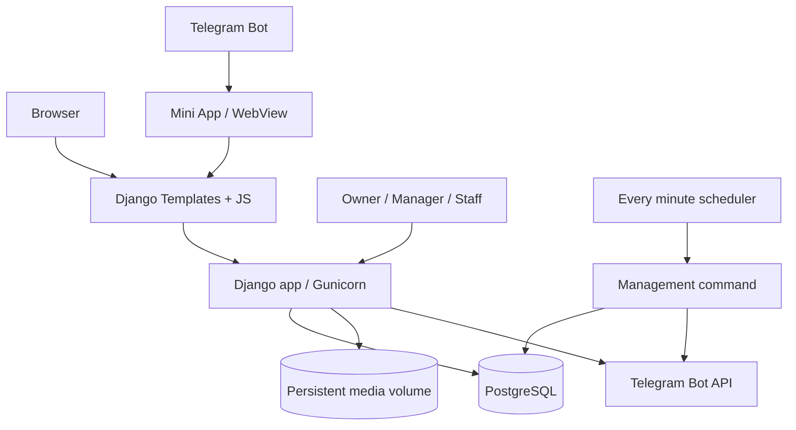
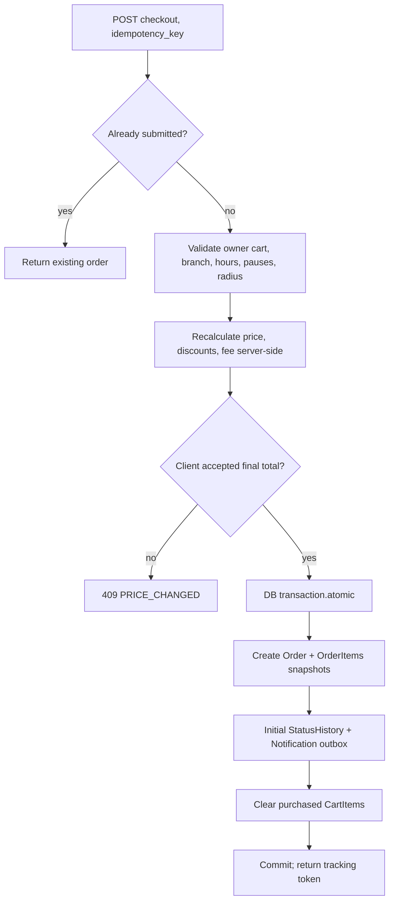

# Django Backend / System Architecture V1.0 (review draft)

## Asosiy tamoyil

**Modular monolith:** Django server-side rendering (Templates), tegishli JSON API endpointlari uchun Django REST Framework, PostgreSQL, media storage, Telegram Bot API, scheduler va Docker Compose. Mikroservis, Redis/Celery, WebSocket va alohida React frontend MVPda talab qilinmaydi.

**White-label:** bitta Git repositoryda bitta mahsulot, har bir tadbirkor uchun bitta mustaqil deployment + DB + domen + media volume + `BusinessProfile` + `BrandTheme`. Bitta biznes ko‘p filiallarga ega bo‘lishi mumkin. Boshqa biznesning customer/order DBsi bilan aralashmaydi.

## Topologiya



Nginx/Caddy HTTPS reverse proxy -> Gunicorn -> Django, alohida DB va persistent media. DNS/domen, HTTPS, staticfile caching, DB backup va media backup deploy qismida.

## Django app chegaralari

```text
delivery/
├── config/                 # settings/, urls.py, wsgi.py/asgi.py
├── apps/
│   ├── accounts/           # User, OTP, TelegramIdentity, staff permissions
│   ├── branding/           # BusinessProfile, BrandTheme, SocialLink
│   ├── branches/           # Branch, BranchHours, delivery radius & pause
│   ├── catalog/            # Category, Product, BranchProduct, Discount
│   ├── carts/              # Cart, CartItem, merge & repricing
│   ├── orders/             # Order, OrderItem, checkout, status transitions
│   ├── notifications/      # Telegram/outbox/scheduled reminders
│   ├── reports/            # reporting queries, XLSX exports
│   └── audit/              # append-only AuditEvent, export audit
├── templates/              # shared storefront + owner UI, no separate frontend root
├── static/                 # CSS theme tokens, JS modules, icons
├── docs/                   # decisions/requirements/database/api/front-end
├── tests/                  # integration + cross-app acceptance tests
├── compose.yaml
├── Dockerfile
├── .env.example
└── AGENTS.md
```

App ichidagi service qatlamlari (masalan `orders/services/checkout.py`, `orders/services/transitions.py`) **faqat murakkab domain ishlariga**; oddiy CRUD uchun alohida abstraksiya majburiy emas. Filiallar, katalog va cart narxini `pricing_service` orqali markazlashtirib hisoblash mumkin, lekin umumiy framework yaratmaymiz.

## Request/business flows

### 1. Katalog va savatcha

- Web / Mini App -> `get_active_branch` -> `BranchProduct` query with `select_related(product, category)`.
- Branch available + Product published + BranchProduct active/available bo‘lsa `Savatga` faol.
- `cart_add` -> owner session/User scope va branch validate -> integer qty <= configured limit.
- `cart_change_quantity` -> current price / discount / availability reprice; frontend oldingi narxdan farq bo‘lsa ogohlantiradi.
- Filial almashsa yangi branchdagi mahsulotlar bilan moslik tekshiriladi; mijoz tasdiqlamaguncha cart silently ko‘chmaydi.

### 2. Checkout (transactional)



Django `transaction.atomic` ichida transaction commit bo‘lmaguncha Telegram HTTP call **qilinmaydi**. Outbox jadvali keyin worker tomonidan yuboriladi. Agar mavjud kodda `on_commit` ishonchli ishlatilsa, outbox bilan moslab ishlatilishi mumkin. Stale yoki unavailable productni checkout qabul qilmaydi. Narx request bodydan olinmaydi.

### 3. Order status

- NEW -> CONFIRMED -> PREPARING -> READY -> COMPLETED (normal);
- NEW -> CANCELED (mijoz yoki filial admin);
- CONFIRMED/PREPARING -> CANCELED (authorized administrator, reason);
- READY -> CANCELED (owner or explicitly delegated manager, reason);
- COMPLETED/CANCELED terminal;
- `payment_status` alohida (UNPAID/PAID), `payment_method` CASH/TERMINAL; payment update audit qilinadi.

Order status o‘zgartirish service'i actor permission + current status + terminal check + `transaction.atomic()` + `select_for_update()` bilan bitta joyda amalga oshiriladi. `OrderStatusHistory` insert shu transactionda. Mijoz cancel qilsa guest secure token yoki account ownership talab qilinadi.

### 4. Reminder / notification

Buyurtma NEW bo‘lib commit qilingach NEW_ORDER notification scheduling; bir vaqtda REMINDER_5M notification `created_at + 5 minutes`ga scheduling. Scheduler har 60 soniyada due notificationlarni status/unique constraints bilan claim qiladi; REMINDER_5M jo‘natish oldidan `Order.status == NEW` qayta tekshiriladi. Bitta reminder hodisasi yuboriladi, auto-cancel yo‘q. Telegram network errors orderga ta’sir qilmaydi, log/retry rejasiga yoziladi. Eslatma **Telegram Mini App configdan mustaqil**.

Idempotent task claim qilish bilan birga tashqi Bot API chaqiruvi paytida natija noma’lum bo‘lsa ikki marta yuborilish xavfi bor; exact-once tashqi yetkazib berish va’da qilinmaydi. Xabar ichida minimal PII (order number/branch/summary) va protected admin detail link.

### 5. Delivery distance

`Haversine(branch.latitude,branch.longitude,customer.latitude,customer.longitude)` to‘g‘ri chiziq km. `distance <= radius` bo‘lsa eligible. Bitta kilometrda emas, haqiqiy km qiymatni Decimal/float bilan erta yaxlitlamasdan solishtirish. Boshqa branch tavsiyasi boshqa filialning `is_active`, delivery_enabled, schedule, pause, radius cheklovlarini tekshiradi; mahsulotlar mavjudligi va narxlar yangi branchga o‘tganda qayta ko‘rib chiqiladi. Pickup radius ishlatmaydi.

### 6. Theme rendering

`branding.context_processors.business_brand` request uchun `BusinessProfile` va validated `BrandTheme`ni beradi; bitta DB ichida profil singleton. Templates CSS variablesni **faqat qattiq validatsiyalangan HEX ranglar**dan yaratadi. Logo va favicon `ImageField`. `SocialLink` URL validatsiyalangan, platform cheklangan. Brend adminida `preview / save / reset defaults`. O‘zgarishlar audit qilinadi. Django template autoescape ishlatiladi; arbitrary raw CSS/HTML/JS saqlanmaydi.

CSS (masalan `static/css/theme.css`):

```css
:root {
  --brand-primary: #117a52;
  --brand-on-primary: #ffffff;
  --brand-accent: #d78a12;
  --brand-page: #f7f8f7;
  --brand-surface: #ffffff;
  --brand-text: #18241e;
  --brand-muted: #59635e;
}
.button-primary { background: var(--brand-primary); color: var(--brand-on-primary); }
```

Admin ranglarini faqat `--brand-*` tokenlarga map qiladi, barcha elementlar ularni o‘qiydi. WCAG 2.2 AA matn kontrasti (odatda 4.5:1; katta matn 3:1) va focus state accessibility tekshiriladi.

## Auth, sessiya va Telegram Mini App

- Browser/SSR va Mini App'ning shu domendagi shared frontend uchun Django **session + CSRF** ishlatiladi; JWTni MVPga majburiy kiritmaymiz, kelajakdagi mustaqil tashqi API uchun rejalash mumkin.
- Web guest session account talab qilmaydi. OTP verified user Django sessionga ulanadi.
- `POST /api/v1/auth/telegram/session/`: Telegram `initData`ni backend serverda hash va auth_date bilan tekshiradi, so‘ng TelegramIdentity -> User yaratadi/topadi va qisqa seansga o'tkazadi. `initDataUnsafe` haqiqiy identity dalili emas. Mini App OFF bo‘lsa endpoint 404/403 va UX ichki tugma yashiriladi.
- Telegram foydalanuvchisining telefoni avtomatik verified deb hisoblanmaydi. Web-account linking -> ochiq rozilik + SMS OTP verification.
- `SameSite`, `Secure`, `HttpOnly` cookie flags prod, CSRF token, CORS minimal, TLS. UI login state noto‘g‘ri yo‘naltiruvchi dizayn bo‘lmasin.
- Guest order tracking uchun yetarlicha entropiyali URL token (DB faqat hash), linkning URLda tarqalishiga qarshi `Referrer-Policy`, short retention va PII minimization.

## Roles & permission matrix (taklif)

| Amal | Guest/Customer | STAFF (branch) | MANAGER (delegated) | OWNER |
|---|---|---|---|---|
| Catalog/Cart/Checkout | Yes | - | - | - |
| Read own order status | Token/ownership | Branch only | Authorized branches | All business |
| NEW confirm/reject | Self-cancel NEW only | Yes | Yes | Yes |
| CONFIRMED/PREPARING cancel | No | if designated admin | Yes | Yes |
| READY cancel | No | No | If explicit permission | Yes |
| Branch service pause | No | Config permission only | Yes | Yes |
| Price/discount/theme edit | No | No by default | Scoped permission | Yes |
| XLSX export/audit | No | No by default | If explicitly authorized | Yes |

Permission server middleware / service/DRF permissionlarida tekshiriladi; frontend tugmani yashirishi yetarli emas.

## Security/operations

- OTP phone/IP rate limits, TTL, one-time, minimal logs; SMS provider failures, cost caps.
- Login, tracking token, cart va order enumerationdan himoya; audit PII/redaction.
- File upload: JPG/PNG/WebP, size/pixel limits, Pillow content verification; unsanitized SVG va executables rad etiladi; image storage webrootda script execute qilmaydi.
- HTTPS, trusted origins, `DEBUG=False`, env secrets, database backup/restore test, media backup, healthchecks, database migrations via CI/CD.
- `python manage.py check --deploy`, `pytest` + PostgreSQL integration, security smoke tests.
- Ordersda `select_related/prefetch_related`, indekslar; N+1 muammosini testdan oldin kuzatish; profiling bo‘lmasa Redis va queue kabi infratuzilmani qo‘shmaslik.
- Standart va Mini App konfiguratsiyasi uchun alohida smoke-testlar; bitta code branch.

## Kichik bizneslarni boshqarish modeli

- Har tadbirkor uchun `DOMAIN`, `DATABASE_URL`, `SECRET_KEY`, `ALLOWED_HOSTS`, `TELEGRAM_BOT_TOKEN`, `MINIAPP_ENABLED`, `TELEGRAM_ADMIN_ALERTS_ENABLED`, `MEDIA_*` kabi env.
- `MINIAPP_ENABLED=false` Mini App UI/login flow o‘chadi, admin Telegram yangiliklari ishlaydi.
- Theme/logos/business phone/social URL va filiallar admin paneldan o‘zgartiriladi (deploy qilmasdan).
- Har biznes alohida DB backup, image media va release healthcheck; codebase umumiy.
